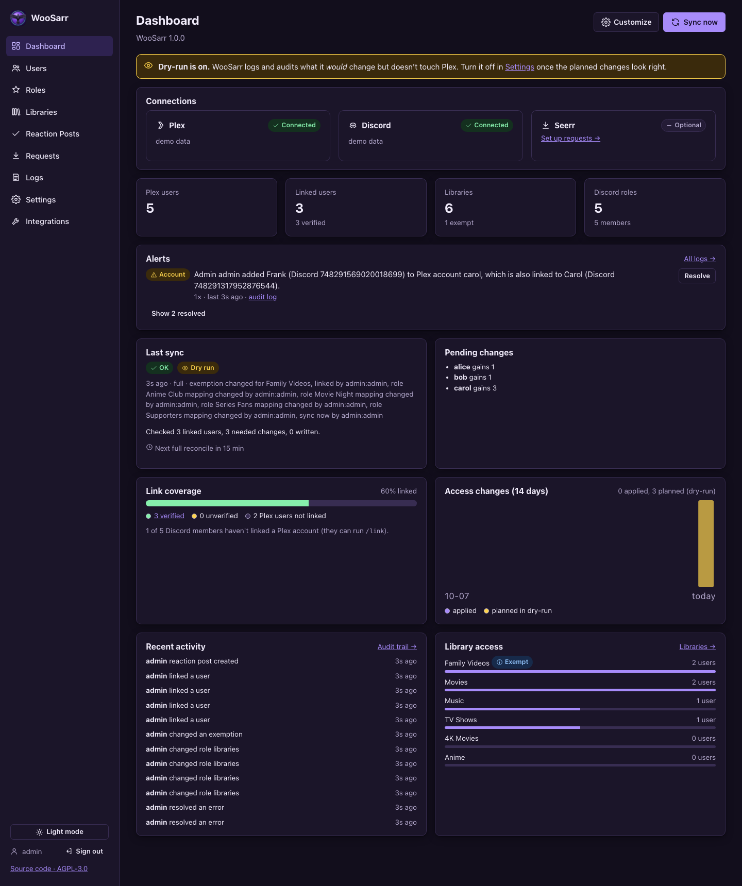
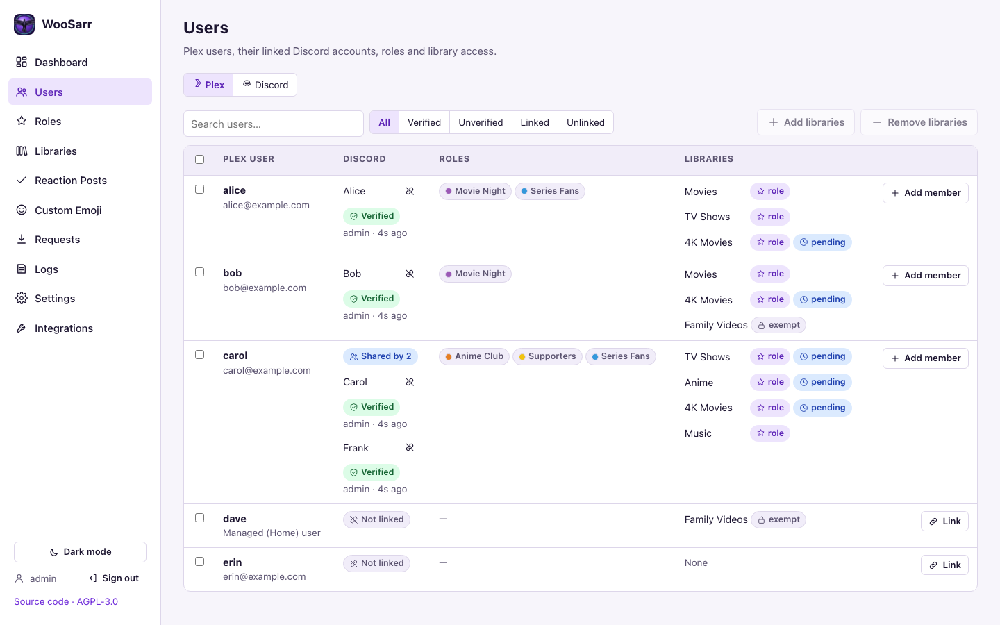
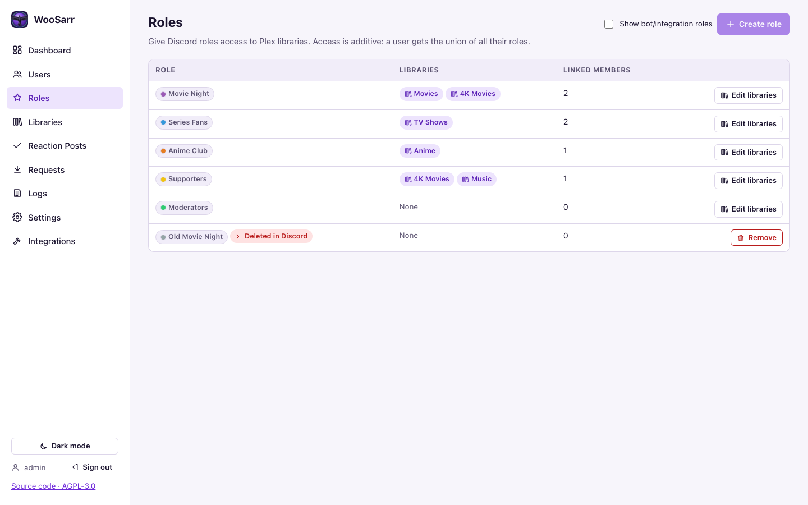
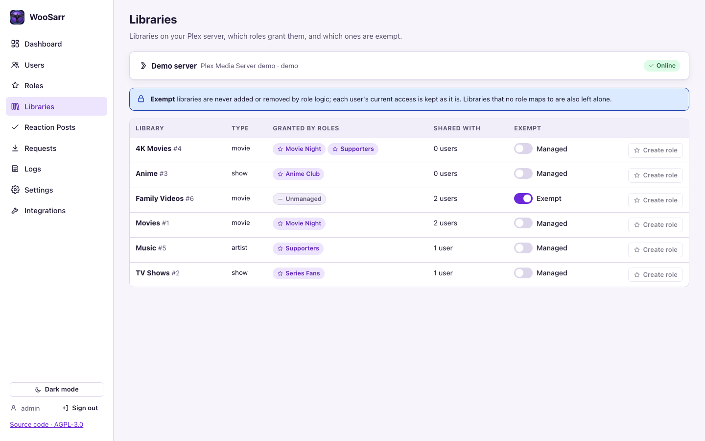
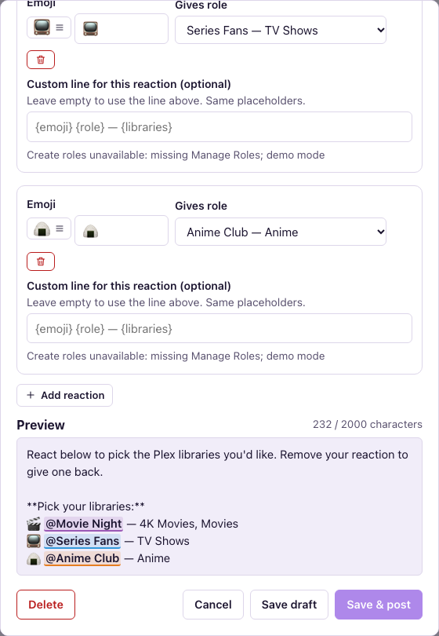
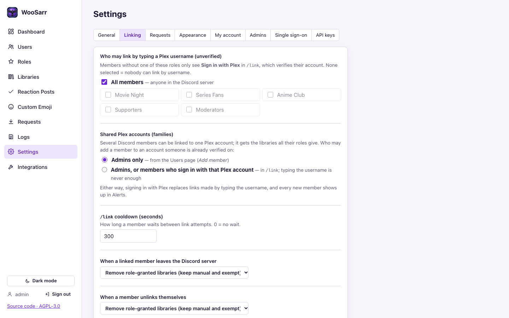
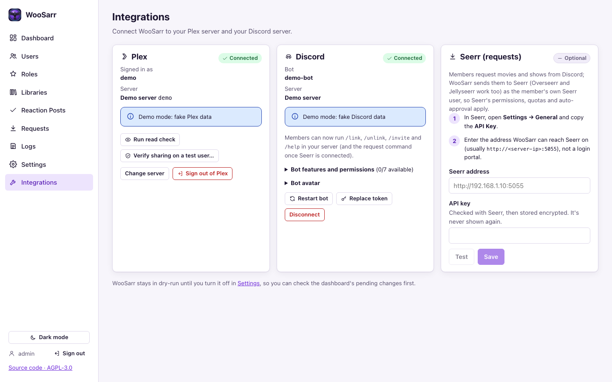

<p align="center"></p>

# WooSarr

WooSarr is a Plex user and library management system with Seerr integration for media requests. 

[](https://ko-fi.com/woosai)



- **Mass actions and manual grants.** Select multiple Plex users and add or remove libraries from them. Or, add or remove roles from Discord users en masse. With one action!
- **Discord roles → Plex libraries.** Map roles to one or more libraries. Users are granted access to libraries matching their roles. Grants are **additive**!  If you have two roles that grant a library, and remove one of those roles, the user retains access.
- **Invite Discord users to Plex.** Admins can use `/invite` to invite Discord users to the Plex server. (Optionally) Users can use `/invite` to invite themselves to the Plex server.
- **Discord bot:** `/link`, `/unlink`, `/invite` (send a Plex invite with the member's role libraries), `/help`, reaction posts (react to get a role), link-status roles (Verified / Unverified / Linked) and adding or removing roles for many members at once.
- **Link Discord users to Plex accounts.** Discord users can link themselves with `/link`: *Sign in with Plex* (verified users) or by typing their Plex username (unverified users). Admins can also link other Discord users in the web UI or with `/link`. 
- **Shared Plex accounts.** Have users with multiple Discord accounts, or multiple Discord users who share a Plex account?  They can share! Allows multiple people access to requesting media, and maintains library access if one user has appropriate roles (Limited to verified accounts only) 
- **Exemptions.** Exempt libraries from management so that they are never touched by roles.
- **Roles via reaction:** Create a post with predefined reactions.  Users who react get prescribed roles.  
- **Custom Emojis:** Have you ever wanted to add an emoji to your Discord server so that your react post could have cool emojis for the role that grants them access to your sweet anime collection, or looked at the movie and tv emoji options and wished there was something better?  Wish no more!  Search emoji.gg, OpenMoji and slackmojis to add emojis to your Discord server (animated ones hidden unless you want them). You can also rename and delete server emojis.
- **Requests through Seerr:** members request movies and shows with `/request` (name configurable) as their own Seerr user, by typing the title or pasting an IMDb, TMDB or TVDB link, and hear back when it's available. Failed requests are retried ([docs/requests.md](docs/requests.md)).
- **Alerts:** warnings, errors and account events on the dashboard until resolved; a full audit trail of every change in the logs.
- **Web UI on port 31337:** customizable dashboard, light/dark themes, colour-vision palettes, live logs, and a check for newer versions.
- **Admin sign-in** with a password or OIDC to your SSO provider: Okta, Microsoft Entra ID, Google, ADFS or any OIDC provider ([docs/sso.md](docs/sso.md)).
- One Docker container (`linux/amd64`, `linux/arm64`) with an Unraid template and a Compose file.
- **Starts in dry-run.** See exactly what would change before anything does; impact previews before every role mapping change, library removal or access-changing setting. Prevents accidental changes to access until configuration is complete. 


## Screenshots

| | |
|---|---|
|  |  |
| **Users**: linked members (one account shared by two), roles, and why each library is there | **Roles**: which libraries each Discord role grants |
|  |  |
| **Libraries**: exemptions and the roles that grant each one | **Reaction posts**: react to get a role, with a live preview |
|  |  |
| **Settings → Linking**: who may link how, shared accounts, leave and unlink rules | **Integrations**: connect Plex, Discord and Seerr |

## Install
UnRAID and Docker installation have been tested and verified.
TrueNAS, Proxmox, and Docker Compose installs have not been verified on a live server.

### Unraid

WooSarr is in Unraid's Community Applications:

1. **Apps** tab → search for **WooSarr** → **Install**.
2. Check the data folder (`/mnt/user/appdata/woosarr`) and WebUI port (`31337`); `PUID`/`PGID` are under *Show more settings* → **Apply**.
3. Docker tab → WooSarr icon → **Logs** for the first-run setup code, then **WebUI** (see [First run](#first-run)).

Updates show on the Docker tab like any other container (**apply update**). Details, development builds and installing without Community Applications (from [`unraid/woosarr.xml`](unraid/woosarr.xml)): [docs/unraid-notes.md](docs/unraid-notes.md).

Prefer Compose (the *Docker Compose Manager* plugin today, built into Unraid 8)? Use [`compose.yaml`](compose.yaml) with `WOOSARR_CONFIG=/mnt/user/appdata/woosarr`; see [Unraid notes → Docker Compose](docs/unraid-notes.md#docker-compose).

### TrueNAS

TrueNAS 24.10 or later: create a dataset owned by the **apps** user (568), then *Apps → Discover Apps → ⋮ → Install via YAML* with [`truenas/compose.yaml`](truenas/compose.yaml) (set your dataset's path in it). WooSarr runs as the apps user with no capabilities. The setup code is in the app's logs. Step by step, updates and backups: [docs/truenas-notes.md](docs/truenas-notes.md). A listing in the TrueNAS Apps catalog is prepared but not yet submitted.

### Proxmox VE

Run Docker in a small Debian 13 LXC (Options → Features: **nesting** and **keyctl**) or a VM, then follow [Docker Compose](#docker-compose) below. Proxmox VE 9.1's OCI-image containers (a technology preview) can also run the image directly. Both, step by step: [docs/proxmox-notes.md](docs/proxmox-notes.md).

### Docker Compose

```bash
curl -fsSLO https://raw.githubusercontent.com/WoosArr/woosarr/main/compose.yaml
docker compose up -d
docker compose logs woosarr   # the first-run setup code
```

Data goes to `./config` next to the file. Change the folder, host port, `PUID`/`PGID` or log level by editing [`compose.yaml`](compose.yaml) or with a `.env` file beside it, for example:

```bash
WOOSARR_CONFIG=/srv/appdata/woosarr
WOOSARR_HOST_PORT=31337
PUID=1000
PGID=1000
```

Update with `docker compose pull && docker compose up -d`.

### Docker

```bash
docker run -d --name woosarr \
  -p 31337:31337 \
  -v /path/to/appdata/woosarr:/config \
  -e PUID=99 -e PGID=100 \
  --security-opt no-new-privileges:true \
  ghcr.io/woosarr/woosarr:latest
```

Images are published for `linux/amd64` and `linux/arm64`. Tags: `latest` (current release), `1.0.0` / `1.0` (a version), `develop` (newest development build, for testing; back up `/config` first, database changes don't go backwards) and `sha-<commit>` (one exact build).

**Which build am I on?** The dashboard and the sidebar show the operating version. Releases use semantic versioning `1.2.0`. Develop builds read similarly, showing the next release's number, then a build number that counts the commits since the last release, the commit and its date. Ex. `1.3.0-dev.14 · develop · ba15809 · 25 Oct 2026`. WooSarr checks GitHub at startup and every 6 hours by default (3 hours down to 5 minutes in *Settings → General*) and says whether you're on the newest build of your channel: releases compare with the newest release, `develop` builds with the newest `develop` build (turn it off in *Settings → General*).

## First run

1. ***IMPORTANT*** Find the **setup code** in the container log (Unraid: Docker tab → WooSarr icon → **Logs**; Compose: `docker compose logs woosarr`):

   ```
   ================================================================
    WooSarr first-run setup code: 1a2b-3c4d-5e6f
   ```

2. Open `http://<host>:31337`, enter the code and create the first admin account (password ≥ 12 characters).
3. **Integrations** page: connect Plex and Discord.
4. **Roles** page: choose which libraries each Discord role grants. **Libraries** page: exempt any library that roles should never touch.
5. **Dashboard**: check *Pending changes*. When they look right, turn off **dry-run** in *Settings → General*.

How access is decided, the pages, the Discord commands, every setting, troubleshooting and backups: [docs/admin-guide.md](docs/admin-guide.md). Bot permissions per feature: [docs/discord-notes.md](docs/discord-notes.md).

## HTTPS and reverse proxies

Port 31337 is plain HTTP. On anything other than a trusted home network, put WooSarr behind a reverse proxy with TLS (Nginx Proxy Manager, SWAG, Caddy, Traefik…), and tell WooSarr to trust the proxy's forwarded headers so session cookies are marked `Secure`:

```bash
-e WOOSARR_FORWARDED_ALLOW_IPS=172.18.0.2   # your proxy's IP as seen by the container
# or, if that's awkward:
-e WOOSARR_COOKIE_SECURE=always
```

Caddy example:

```
woosarr.example.com {
    reverse_proxy woosarr:31337
}
```

Don't expose port 31337 directly to the internet.

## Logs and troubleshooting

- **Dashboard → Alerts**: open warnings, errors and account events, grouped, with **Resolve**.
- **Logs** page: live application log and the audit trail of every access change.
- Without a browser session, create a **read** API key (*Settings → API keys*) and:

  ```bash
  curl -H "Authorization: Bearer wsk_…" "http://<host>:31337/api/v1/logs?level=WARNING&limit=200"
  curl -H "Authorization: Bearer wsk_…" -o woosarr.log "http://<host>:31337/api/v1/logs/file"
  curl -H "Authorization: Bearer wsk_…" -o alerts.log "http://<host>:31337/api/v1/logs/file?name=alerts"
  ```

  Log files live in `/config/logs`: `woosarr.log` (everything, 5 MB × 6 files) and `alerts.log` (warnings and errors only, 2 MB × 3 files, so they're kept much longer).

- Set the log level to DEBUG in *Settings → General* (or `WOOSARR_LOG_LEVEL=DEBUG`). Secrets are always redacted.
- Forgot the admin password: `python -m woosarr.admin reset-password <user> --generate` in the container console.

## Backups

Back up `/config` (the database, logs and `secrets/master.key`). The master key decrypts the stored Plex and Discord tokens; keep a copy somewhere other than the database backup, or supply it with `WOOSARR_MASTER_KEY_FILE`. See [docs/admin-guide.md#backup-and-restore-p12-03](docs/admin-guide.md#backup-and-restore-p12-03).

## FAQ

**Will WooSarr remove libraries I shared by hand?** Only libraries that a role manages. Libraries no role maps to, and exempt libraries, are left exactly as they are.

**A user lost a role but still has the library.** Another role, a manual grant or an exemption still gives it; the Users page shows each library's source.

**Someone linked the wrong Plex account.** Unlink them on the Users page. A Plex sign-in (verified) link replaces a typed-username (unverified) claim, and every attempt to link an account someone else holds shows up in **Alerts**. You can limit typed-username linking to chosen roles, or ignore unverified links entirely (*Settings → Linking* and *General*).

**Our family shares one Plex login but has several Discord accounts.** Link them all to the same Plex account: an admin uses **Add member** on the Users page, or (if *Settings → Linking → Shared Plex accounts* allows it) each member signs in with Plex in `/link`. The account gets the libraries all their roles give.

**A reaction post won't publish.** The bot needs View Channels, Send Messages, Add Reactions and Read Message History in that channel (channel permission overrides win over server roles). The post is saved anyway; a toast and the Alerts widget say which permission is missing. *Integrations → Discord → Bot features and permissions* shows what the bot can do.

**Does WooSarr store Plex passwords or user tokens?** No. `/link` sign-ins (arriving with the Discord bot) use a one-time token that is invalidated straight after reading the username. Only the server owner's Plex token, the bot token, the Seerr API key and any SSO client secrets are stored, all encrypted.

**Another bot already has `/request`.** Both work; Discord shows each with its bot's name. Rename WooSarr's in *Settings → Requests* or hide the other bot's under *Server Settings → Integrations* ([docs/requests.md](docs/requests.md#another-bot-already-has-request)).

**Can I try it without connecting anything?** Yes: `WOOSARR_DEMO=true` uses a fake Plex server and Discord data. Don't use it on a real install.

## Documentation

| Doc | For |
|-----|-----|
| [Admin guide](docs/admin-guide.md) | How access is decided, the pages, Discord commands, shared accounts, dashboard and alerts, every setting, troubleshooting, backups, environment variables |
| [Discord notes](docs/discord-notes.md) | Bot setup, permissions per feature, `/link`, `/unlink`, `/invite`, reaction posts, custom emoji, link-status roles, bot avatar |
| [Requests](docs/requests.md) | `/request` through Seerr: setup, search and pasted links, who may request, public or private, failed requests, diagnostics |
| [Single sign-on](docs/sso.md) | OIDC providers for admin sign-in |
| [Plex notes](docs/plex-notes.md) | How WooSarr talks to Plex and what was verified on a real server |
| [Unraid notes](docs/unraid-notes.md) | The Unraid template, Community Applications, development builds, Docker Compose |
| [TrueNAS notes](docs/truenas-notes.md) | Install via YAML as the apps user; the TrueNAS Apps catalog listing |
| [Proxmox notes](docs/proxmox-notes.md) | Docker Compose in an LXC or VM; OCI image as an LXC (9.1+) |
| [Threat model](docs/threat-model.md) | What's protected and how |
| [Changelog](CHANGELOG.md) | What changed |

## Develop

```bash
make install   # backend venv + frontend deps
make check     # lint + tests (backend and frontend) + UI build + contrast check
make demo      # run on http://localhost:31337 with fake Plex/Discord data
make e2e       # Playwright UI tests
make screenshots  # regenerate docs/images from the demo backend
```

Security notes: [docs/threat-model.md](docs/threat-model.md).

## Releases

Development happens on `develop`: please open pull requests against `develop`, not `main` (the default branch, which only changes when a release is merged). Every push to `develop` runs CI and, if it passes, publishes a **`ghcr.io/woosarr/woosarr:develop`** image for testing (not for everyday use; it never becomes `latest`). `main` is the release branch: each release is a merge to `main` plus a version tag on it (`v1.2.3` → `1.2.3`, `1.2` and, for the newest release, `latest`, all one image). They run CI (lint, tests, UI tests, audits, secret scan), smoke-test the image (also through `compose.yaml` and `truenas/compose.yaml`), scan it for secrets and vulnerabilities, then publish `linux/amd64` and `linux/arm64` images to GitHub Container Registry.

## License

[GNU Affero General Public License v3.0](LICENSE) (AGPL-3.0-only). You can use, change and share WooSarr freely; if you distribute a modified version, or let others use one over a network, you must make its source code available under the same licence.

## Disclaimer

WooSarr is an independent project. It is not affiliated with, endorsed by, or part of the [Servarr](https://wiki.servarr.com/) project or its apps (Sonarr, Radarr, Lidarr, Readarr, Prowlarr and others). The "-arr" in the name only nods to that family of self-hosted media tools.
