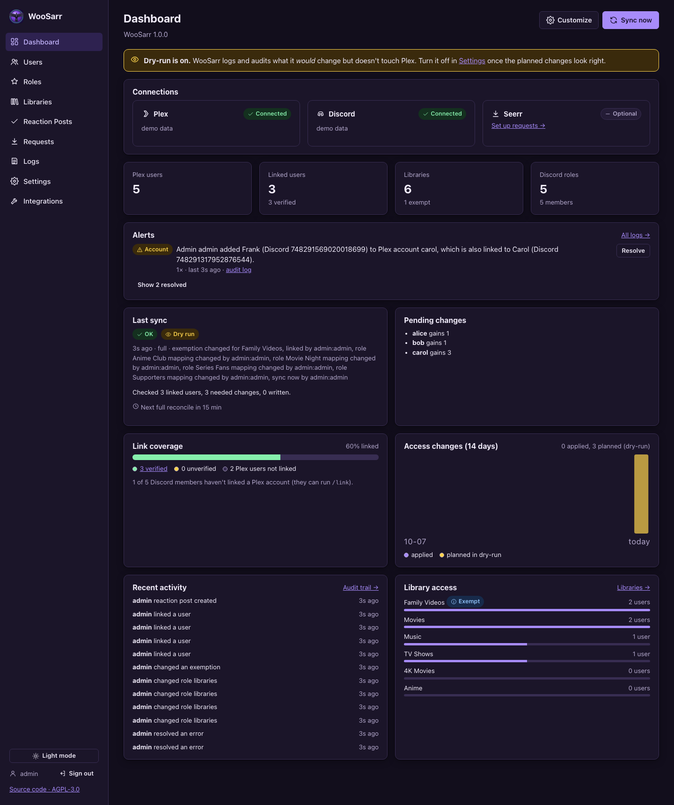
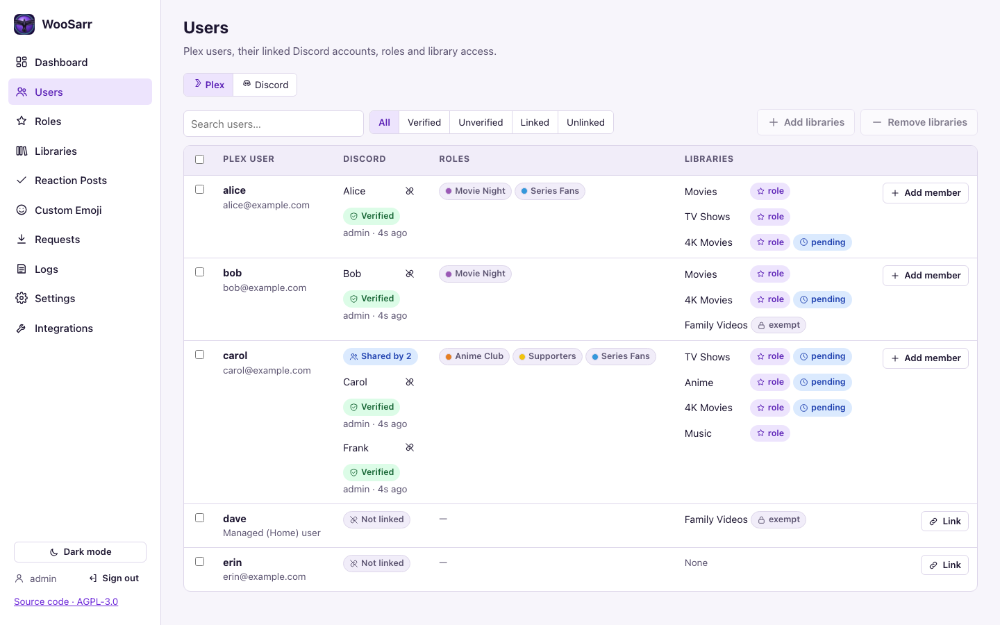
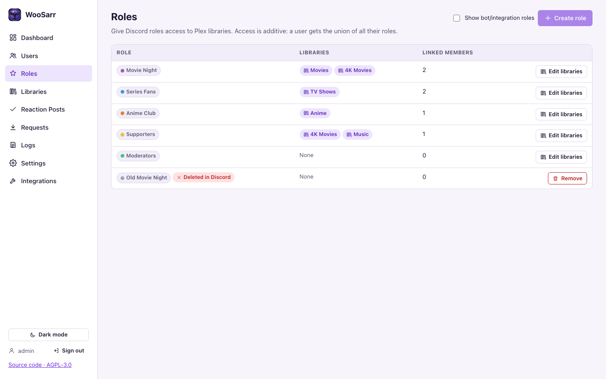
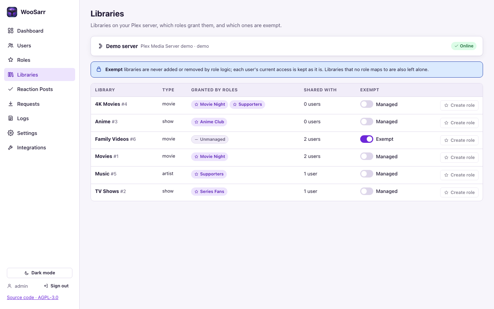
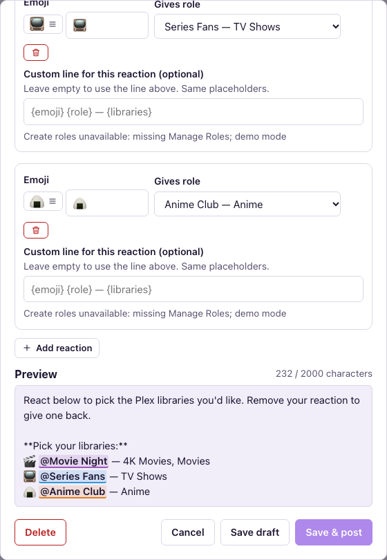
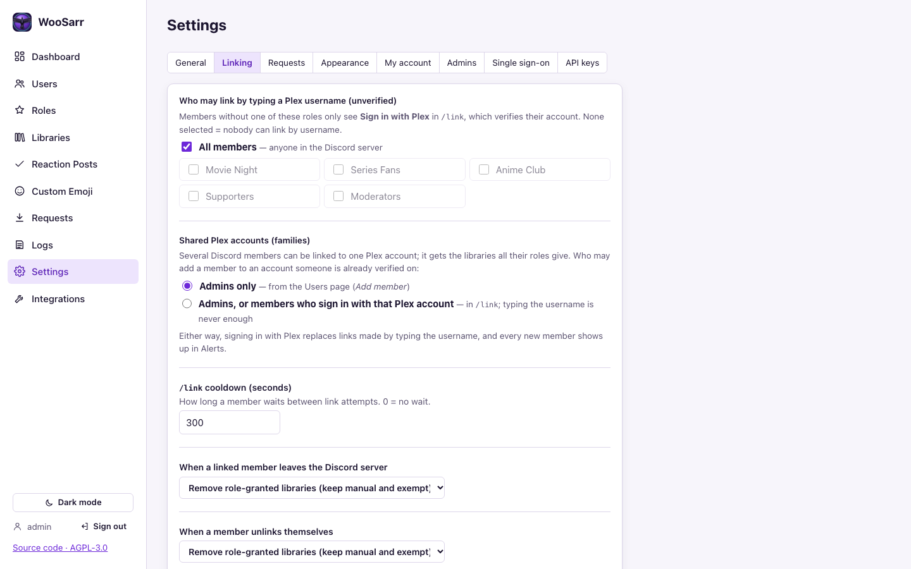
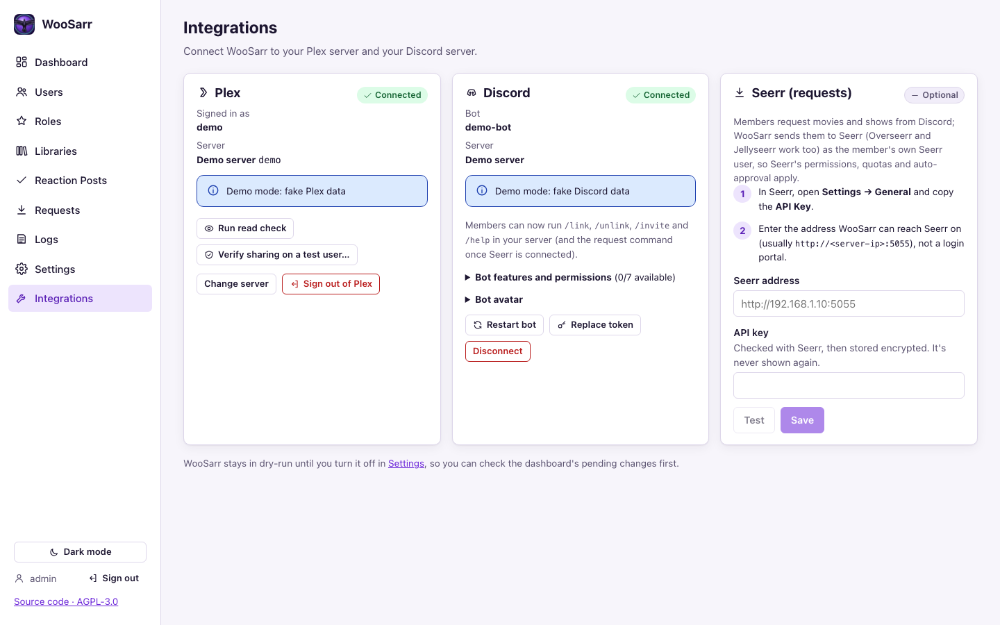

<p align="center"></p>

# WooSarr

Automatically grants and removes **Plex library access** based on **Discord roles**.

[](https://ko-fi.com/woosai)



- **Discord roles → Plex libraries.** Map each role to libraries; members get the union of all their roles. Grants are **additive**: a library stays if any role, manual grant or exemption keeps it.
- **Only linked users are managed.** Members link themselves with `/link`: *Sign in with Plex* (verified; the one-time token is invalidated straight away) or by typing their Plex username (unverified, can be limited to chosen roles).
- **Shared Plex accounts.** Several Discord members can share one Plex account (a family); it gets the libraries all their roles give.
- **Starts in dry-run.** See exactly what would change before anything does; impact previews before every role, removal or settings change.
- **Exemptions and manual grants.** Exempt libraries are never touched by roles; admins can grant or remove libraries per user.
- **Discord bot:** `/link`, `/unlink`, `/invite` (send a Plex invite with the member's role libraries), `/help`, reaction posts (react to get a role) and link-status roles (Verified / Unverified / Linked).
- **Custom Emoji:** search emoji.gg, OpenMoji and slackmojis and add emoji to your Discord server (animated ones hidden unless you want them); rename and delete server emoji.
- **Requests through Seerr:** members request movies and shows with `/request` (name configurable) as their own Seerr user, and hear back when it's available ([docs/requests.md](docs/requests.md)).
- **Alerts:** warnings, errors and account events (someone trying to link an account that isn't theirs, takeovers, new family members) on the dashboard until resolved; a full audit trail of every change.
- **Web UI on port 31337:** customizable dashboard, light/dark themes, colour-vision palettes, live logs.
- **Admin sign-in** with a password or OpenID Connect single sign-on: Okta, Microsoft Entra ID, Google, ADFS or any OIDC provider ([docs/sso.md](docs/sso.md)).
- One Docker container (`linux/amd64`, `linux/arm64`) with an Unraid template and a Compose file.

> **Status:** in use on a real Plex server and Discord server, and available in Unraid's **Community Applications** (Apps tab → search *WooSarr*). See [docs/action-plan.md](docs/action-plan.md).

## Screenshots

| | |
|---|---|
|  |  |
| **Users**: linked members (one account shared by two), roles, and why each library is there | **Roles**: which libraries each Discord role grants |
|  |  |
| **Libraries**: exemptions and the roles that grant each one | **Reaction posts**: react to get a role, with a live preview |
|  |  |
| **Settings → Linking**: who may link how, shared accounts, leave and unlink rules | **Integrations**: connect Plex, Discord and Seerr |

All screenshots use WooSarr's demo mode (a fake Plex server and Discord guild); `make screenshots` regenerates them.

## Install

### Unraid

WooSarr is in Unraid's Community Applications:

1. **Apps** tab → search for **WooSarr** → **Install**.
2. Check the settings (data folder `/mnt/user/appdata/woosarr`, WebUI port `31337`, `PUID`/`PGID`) → **Apply**.
3. Docker tab → WooSarr icon → **Logs** for the first-run setup code, then **WebUI** (see [First run](#first-run)).

Updates show on the Docker tab like any other container (**apply update**). Details, development builds and installing without Community Applications (from [`unraid/woosarr.xml`](unraid/woosarr.xml)): [docs/unraid-notes.md](docs/unraid-notes.md).

Prefer Compose (the *Docker Compose Manager* plugin today, built into Unraid 8)? Use [`compose.yaml`](compose.yaml) with `WOOSARR_CONFIG=/mnt/user/appdata/woosarr`; see [Unraid notes → Docker Compose](docs/unraid-notes.md#docker-compose).

### Docker Compose

```bash
curl -fsSLO https://raw.githubusercontent.com/WoosArr/woosarr/main/compose.yaml
docker compose up -d
docker compose logs woosarr   # the first-run setup code
```

Data goes to `./config` next to the file. Change the folder, host port, `PUID`/`PGID` or log level by editing [`compose.yaml`](compose.yaml) or with a `.env` file beside it, for example:

```bash
WOOSARR_CONFIG=/srv/appdata/woosarr
WOOSARR_HOST_PORT=31337
PUID=1000
PGID=1000
```

Update with `docker compose pull && docker compose up -d`.

### Docker

```bash
docker run -d --name woosarr \
  -p 31337:31337 \
  -v /path/to/appdata/woosarr:/config \
  -e PUID=99 -e PGID=100 \
  --security-opt no-new-privileges:true \
  ghcr.io/woosarr/woosarr:latest
```

Images are published for `linux/amd64` and `linux/arm64`. Tags: `latest` (current release), `1.0.0` / `1.0` (a version), `develop` (newest development build, for testing; back up `/config` first, database changes don't go backwards) and `sha-<commit>` (one exact build).

## First run

1. Find the **setup code** in the container log (Unraid: Docker tab → WooSarr icon → **Logs**; Compose: `docker compose logs woosarr`):

   ```
   ================================================================
    WooSarr first-run setup code: 1a2b-3c4d-5e6f
   ```

2. Open `http://<host>:31337`, enter the code and create the first admin account (password ≥ 12 characters).
3. **Integrations** page: connect Plex and Discord.
4. **Roles** page: choose which libraries each Discord role grants. **Libraries** page: exempt any library that roles should never touch.
5. **Dashboard**: check *Pending changes*. When they look right, turn off **dry-run** in *Settings → General*.

How access is decided, the Discord commands, troubleshooting, backups and all settings: [docs/admin-guide.md](docs/admin-guide.md). Bot permissions per feature: [docs/discord-notes.md](docs/discord-notes.md).

## HTTPS and reverse proxies

Port 31337 is plain HTTP. On anything other than a trusted home network, put WooSarr behind a reverse proxy with TLS (Nginx Proxy Manager, SWAG, Caddy, Traefik…), and tell WooSarr to trust the proxy's forwarded headers so session cookies are marked `Secure`:

```bash
-e WOOSARR_FORWARDED_ALLOW_IPS=172.18.0.2   # your proxy's IP as seen by the container
# or, if that's awkward:
-e WOOSARR_COOKIE_SECURE=always
```

Caddy example:

```
woosarr.example.com {
    reverse_proxy woosarr:31337
}
```

Don't expose port 31337 directly to the internet.

## Logs and troubleshooting

- **Dashboard → Alerts**: open warnings, errors and account events, grouped, with **Resolve**.
- **Logs** page: live application log and the audit trail of every access change.
- Without a browser session, create a **read** API key (*Settings → API keys*) and:

  ```bash
  curl -H "Authorization: Bearer wsk_…" "http://<host>:31337/api/v1/logs?level=WARNING&limit=200"
  curl -H "Authorization: Bearer wsk_…" -o woosarr.log "http://<host>:31337/api/v1/logs/file"
  curl -H "Authorization: Bearer wsk_…" -o alerts.log "http://<host>:31337/api/v1/logs/file?name=alerts"
  ```

  Log files live in `/config/logs`: `woosarr.log` (everything, 5 MB × 6 files) and `alerts.log` (warnings and errors only, 2 MB × 3 files, so they're kept much longer).

- Set the log level to DEBUG in *Settings → General* (or `WOOSARR_LOG_LEVEL=DEBUG`). Secrets are always redacted.
- Forgot the admin password: `python -m woosarr.admin reset-password <user> --generate` in the container console.

## Backups

Back up `/config` (the database, logs and `secrets/master.key`). The master key decrypts the stored Plex and Discord tokens; keep a copy somewhere other than the database backup, or supply it with `WOOSARR_MASTER_KEY_FILE`. See [docs/admin-guide.md#backup-and-restore-p12-03](docs/admin-guide.md#backup-and-restore-p12-03).

## FAQ

**Will WooSarr remove libraries I shared by hand?** Only libraries that a role manages. Libraries no role maps to, and exempt libraries, are left exactly as they are.

**A user lost a role but still has the library.** Another role, a manual grant or an exemption still gives it; the Users page shows each library's source.

**Someone linked the wrong Plex account.** Unlink them on the Users page. A Plex sign-in (verified) link replaces a typed-username (unverified) claim, and every attempt to link an account someone else holds shows up in **Alerts**. You can limit typed-username linking to chosen roles, or ignore unverified links entirely (*Settings → Linking* and *General*).

**Our family shares one Plex login but has several Discord accounts.** Link them all to the same Plex account: an admin uses **Add member** on the Users page, or (if *Settings → Linking → Shared Plex accounts* allows it) each member signs in with Plex in `/link`. The account gets the libraries all their roles give.

**A reaction post won't publish.** The bot needs View Channels, Send Messages, Add Reactions and Read Message History in that channel (channel permission overrides win over server roles). The post is saved anyway; a toast and the Alerts widget say which permission is missing. *Integrations → Discord → Bot features and permissions* shows what the bot can do.

**Does WooSarr store Plex passwords or user tokens?** No. `/link` sign-ins (arriving with the Discord bot) use a one-time token that is invalidated straight after reading the username. Only the server owner's Plex token and the bot token are stored, encrypted.

**Another bot already has `/request`.** Both work; Discord shows each with its bot's name. Rename WooSarr's in *Settings → Requests* or hide the other bot's under *Server Settings → Integrations* ([docs/requests.md](docs/requests.md#another-bot-already-has-request)).

**Can I try it without connecting anything?** Yes: `WOOSARR_DEMO=true` uses a fake Plex server and Discord data. Don't use it on a real install.

## Documentation

| Doc | For |
|-----|-----|
| [Admin guide](docs/admin-guide.md) | How access is decided, Discord commands, shared accounts, dashboard and alerts, troubleshooting, backups, environment variables |
| [Discord notes](docs/discord-notes.md) | Bot setup, permissions per feature, `/link`, `/unlink`, `/invite`, reaction posts, custom emoji, link-status roles, bot avatar |
| [Requests](docs/requests.md) | `/request` through Seerr: setup, who may request, public or private, diagnostics |
| [Single sign-on](docs/sso.md) | OIDC providers for admin sign-in |
| [Plex notes](docs/plex-notes.md) | How WooSarr talks to Plex and what was verified on a real server |
| [Unraid notes](docs/unraid-notes.md) | The Unraid template |
| [Threat model](docs/threat-model.md) | What's protected and how |
| [Changelog](CHANGELOG.md) | What changed |

## Develop

```bash
make install   # backend venv + frontend deps
make check     # lint + tests (backend and frontend) + UI build + contrast check
make demo      # run on http://localhost:31337 with fake Plex/Discord data
make e2e       # Playwright UI tests
make screenshots  # regenerate docs/images from the demo backend
```

Security notes: [docs/threat-model.md](docs/threat-model.md).

## Releases

Development happens on `develop`: please open pull requests against `develop`, not `main` (the default branch, which only changes when a release is merged). Every push runs CI and, if it passes, publishes a **`ghcr.io/woosarr/woosarr:develop`** image for testing (not for everyday use; it never becomes `latest`). `main` is the release branch: each release is a merge to `main` plus a version tag on it (`v1.2.3` → `1.2.3`, `1.2` and, for the newest release, `latest`, all one image). They run CI (lint, tests, UI tests, audits, secret scan), smoke-test the image (also through `compose.yaml`) and secret-scan it, then publish `linux/amd64` and `linux/arm64` images to GitHub Container Registry.

## License

[GNU Affero General Public License v3.0](LICENSE) (AGPL-3.0-only). You can use, change and share WooSarr freely; if you distribute a modified version, or let others use one over a network, you must make its source code available under the same licence.

Versions published before 2026-10-19 (including v0.1.0) were released under the MIT licence.

## Disclaimer

WooSarr is an independent project. It is not affiliated with, endorsed by, or part of the [Servarr](https://wiki.servarr.com/) project or its apps (Sonarr, Radarr, Lidarr, Readarr, Prowlarr and others). The "-arr" in the name only nods to that family of self-hosted media tools.
