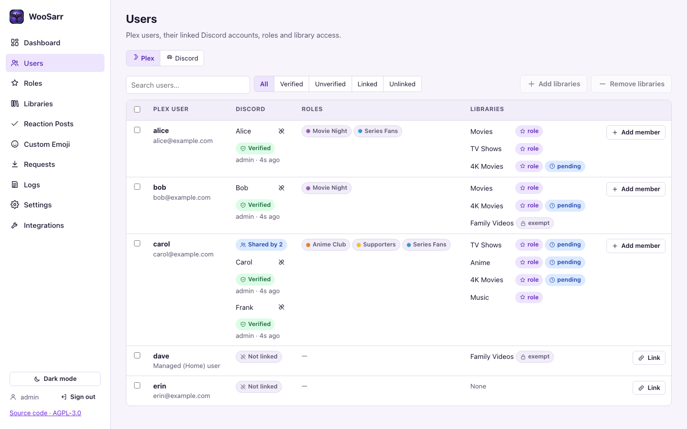
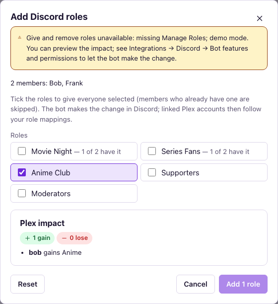
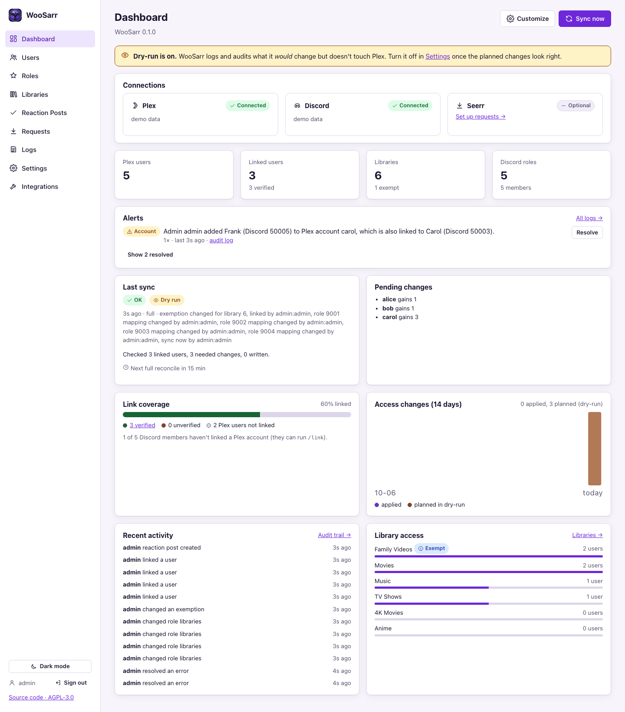

# WooSarr admin guide

How WooSarr decides who sees which Plex library, and how to look after it.

## How access is decided (P12-02)

WooSarr manages a Plex user only if they are **linked** to a Discord account. For each linked user it computes the complete list of libraries they should have, and writes that list to Plex.



| Source | Meaning | Shown as |
|--------|---------|----------|
| **Role** | A Discord role the member holds is mapped to the library (Roles page). | `role` |
| **Manual** | An admin granted it on the Users page. Kept no matter which roles the user has. | `manual` |
| **Exempt** | The library is exempt (Libraries page). Role changes never add or remove it; whatever the user has stays. | `exempt` |
| **External** | Shared in Plex directly and no role manages that library. WooSarr leaves it alone. | `external` |

The rules:

1. **Additive.** A user gets the union of all their roles' libraries (for a shared account, all its members' roles). Losing one role only removes a library if no other role, manual grant or exemption keeps it.
2. **Exempt libraries are frozen.** Role logic never touches them, in either direction.
3. **Unmanaged libraries are left alone.** A library no role maps to isn't removed from anyone.
4. **Only linked users.** Unlinked Plex users are never changed. Unlinking someone stops management; their current shares stay.
5. **Complete sets.** Plex replaces the whole share list on every update, so WooSarr always sends the full list (never a partial one) and re-reads the user's live shares right before writing. If they changed in the meantime, it skips that user and tries again on the next sync.

### When syncs happen

- Right away (after a few seconds of debounce) when a member's roles change, a role is edited or deleted, a member joins or leaves, a link changes, or you change a manual grant.
- A full reconcile when you change a role mapping, an exemption, or certain settings, and on a schedule (default every 15 minutes).
- **Sync now** on the dashboard or the Libraries page (a full sync that also re-reads library names from Plex).

### Libraries removed from Plex, roles deleted in Discord

- **A library is deleted in Plex**: the next full sync marks it *Missing on server* (Libraries page) and removes everything that pointed at it: role mappings, manual grants, the shares WooSarr had seen, and dashboard filters for it (audited as `library_forgotten`, listing the roles and users it had). WooSarr never tries to share it again, and it can't be mapped or granted any more. If Plex suddenly lists no libraries at all, WooSarr treats it as a glitch and changes nothing.
- **A role is deleted in Discord**: members lose it at once, and a sync takes away the libraries that only it gave. After the next full sync that runs live and without errors, WooSarr removes the role's mappings, the settings that named it (link roles, who may invite / request / link by username), its reaction post options and dashboard filters (audited as `role_removed`, by WooSarr). In dry-run they stay, listed on the Roles page as *Deleted in Discord*, where **Remove** does it by hand. Mapped role ids WooSarr has never seen in Discord are only removed by hand.
- **Hide deleted items** (*Settings → General*, on by default) leaves these out of the web UI's lists: libraries missing on the Plex server (Libraries), roles deleted in Discord (Roles; turn it off to use **Remove**), Plex users no longer shared with (Users) and requests removed in Seerr (Requests). Each page says how many it hid. The API still returns them.

### Discord commands

- `/help`: lists the commands below with their options (only the asker sees it; `/request` appears only when Seerr is set up).
- `/link`: link your Plex account (Plex sign-in = verified, or typed username). *Settings → Linking → Who may link by typing a Plex username* can limit the typed-username option to chosen roles; everyone else only sees Plex sign-in, and a typed username from them is refused (audited as `link_failed`, reason `username_link_not_allowed`). Admins can link someone else with `/link member plex_user` (verified, like *Link* on the Users page).
- `/unlink`: remove your own link. What happens to access is set under *Settings → Linking → When a member unlinks themselves*.
- `/request title` (name set in *Settings → Requests*, default `/request`): request a movie or show through Seerr as the member's own Seerr user. Members type the title and pick a suggestion, or paste the title's IMDb, TMDB or TVDB link. Needs Seerr connected on the Integrations page and a linked (by default verified) Plex account. See [requests.md](requests.md).
- `/invite email [member]`: send a Plex invite whose libraries come from the member's roles. Members can invite themselves if they hold a role chosen under *Settings → Linking → Plex Invites* (or anyone, if that's ticked; nobody by default); admins (*Settings → Linking → Admin roles*) can invite for anyone. Accepted invites link automatically, within about a minute of being accepted; pending ones are listed on the Users page. Not available in dry-run.

### Discord roles managed by WooSarr

- Link-status roles (Verified / Unverified / Linked), per-library roles and reaction posts (react to get a role): see [Discord notes](discord-notes.md).
- Bot permissions per feature, and how to grant only what you need: [Discord notes → Bot permissions by feature](discord-notes.md#bot-permissions-by-feature).

### Custom emoji

The **Custom Emoji** page searches emoji.gg, OpenMoji and slackmojis and adds emoji to your Discord server (animated ones are hidden unless you turn *Hide animated* off); it also renames and deletes the server's emoji. Added emoji appear in the reaction post picker straight away. Previews are fetched by WooSarr, never by your browser. Details, limits and the permissions the bot needs: [Discord notes → Custom emoji](discord-notes.md#custom-emoji).

### Users page: Plex and Discord tabs

- **Plex** (default): every Plex user, their linked Discord members, roles and where each library comes from; **Add libraries** / **Remove libraries** for the selected users; **Link** / **Add member**.
- **Discord**: every member of your Discord server with their roles and linked Plex account, with the same *All / Verified / Unverified / Linked / Unlinked* filters and a search box. Select members, then:
  - **Add roles**: tick roles to give everyone selected (members who already have one are skipped).
  - **Remove roles**: ✓ all selected have it, – some do; untick a role to take it from everyone who has it.
  - Both show a **Plex impact** preview: which linked Plex accounts would gain or lose which libraries through your role mappings (shared accounts use all their members' roles). The bot then makes the change in Discord and the linked accounts sync.
  - Needs the bot feature *Give and remove roles* (Manage Roles; the bot's highest role above the roles it gives). Bot and integration roles, @everyone and roles above the bot's are refused before anything changes; each member's result is listed, and the change is audited (`discord_roles_changed_admin`). Up to 200 members at a time.



### Removing access by hand

Users page → select users → **Remove libraries**. Each library shows what the selected users have now (from the last sync): ✓ all have it, – some do, empty: nobody (disabled). Untick a library to remove it from everyone who has it; the dialog previews who loses what before you confirm, **Reset** clears your changes, and after removing, **Undo** gives everything back (including deleted manual grants; audited as `access_restored_admin`). It removes those libraries from the users in Plex now, together with any manual grants for them (dry-run respected, audited as `access_removed_admin`). For a linked user, libraries their Discord roles grant are kept and listed, because the next sync would add them back: remove the role in Discord or change the role mapping instead. For unlinked users WooSarr doesn't manage access, so nothing re-adds a removed library.

### Members who leave the Discord server

Default: their role-granted libraries are removed; manual grants and exempt libraries stay. Change this under *Settings → Linking*.

### Verified and unverified links

- **Verified**: the user signed in to Plex during `/link`, or an admin created the link.
- **Unverified**: the user typed a Plex username. It isn't proven. A verified link to the same Plex account replaces it.
- Turn on *Ignore unverified links* to manage only verified users.

### Shared Plex accounts (families)

Several Discord members can be linked to one Plex account, for example a family that shares a login. A Discord member still has only one link.

- **Access** is the union: the account gets every library any of its members' roles give (plus manual grants and exempt libraries, as always). The Users page shows *Shared by N*, each member with their own unlink button, and the roles of all members.
- **Adding a member** (*Settings → Linking → Shared Plex accounts*):
  - *Admins only* (default): **Add member** on the Users page, or `/link member plex_user` in Discord.
  - *Admins, or members who sign in with that Plex account*: also `/link` → **Sign in with Plex**. Typing the username is never enough to join someone else's account.
  - Either way, signing in with Plex replaces links other members made by typing the username (they're unproven), and every new member on an account others are linked to shows up in **Alerts**.
- **A member leaves the Discord server** (*When a linked member leaves the Discord server*): *Remove role-granted libraries* drops what only their roles gave and keeps what the others' roles give; *Leave their access as it is* keeps counting their last known roles. If every member has left, it works as for a single member.
- **A member unlinks** (`/unlink`, or the unlink button on the Users page): the account stays linked to the others. *Remove role-granted libraries* drops what only their roles gave; *Leave their access as it is* turns those libraries into manual grants (audited as `manual_grant_kept`), so nothing is taken away and an admin can remove them later. The last member unlinking works as for a single member.

## The pages

| Page | What it's for |
|------|---------------|
| **Dashboard** | Widgets for status, alerts, pending changes and activity; **Sync now** ([below](#dashboard)). |
| **Users** | *Plex* tab: every Plex user, their linked members, roles and where each library comes from; link, add a member, add or remove libraries. *Discord* tab: every server member; add or remove roles for many at once ([above](#users-page-plex-and-discord-tabs)). Pending Plex invites are listed here too. |
| **Roles** | Each Discord role with the libraries it grants and its linked members. **Edit** a role's libraries (with an impact preview before saving), **Create role** in Discord and map it straight away, and **Remove** roles deleted in Discord. |
| **Libraries** | Every library on the Plex server: who it's shared with, which roles grant it, and the **Exempt** switch. **Create role** makes a `Plex · <library>` role mapped to it; **Sync now**. Libraries deleted in Plex show as *Missing on server*. |
| **Reaction Posts** | Messages members react to for a role ([Discord notes → Reaction posts](discord-notes.md#reaction-posts)). |
| **Custom Emoji** | Add emoji from emoji.gg, OpenMoji and slackmojis to the server; rename and delete server emoji ([Discord notes → Custom emoji](discord-notes.md#custom-emoji)). |
| **Requests** | Requests made with `/request`: member, title, status, when it was last checked; **Check status now** and **Retry** for failed ones ([requests.md](requests.md)). |
| **Logs** | *Application log*: live, filter by level, search. *Audit trail*: every access change, link, mapping and settings change, with who did it; **Load older**. |
| **Settings** | All settings ([below](#settings)). |
| **Integrations** | Connect Plex, Discord and Seerr. Plex: **Verify sharing on a test user…**. Discord: *Bot features and permissions* (with an invite link for exactly those), *Bot avatar*, **Restart bot**. |

## Dashboard



The dashboard is made of widgets on an 8-column grid. **Customize** lets each admin move (↑/↓), resize (**eighth**, **quarter**, **half** or **full** width; 4 columns on tablets, 2 on phones) and hide widgets, choose how chartable widgets are drawn (their usual form, a **Circle** or **Bars**), and add hidden ones back from *More widgets*; **Save layout** stores it for your admin account, **Reset to default** brings back WooSarr's layout.

In *Customize* you can also **rename** any widget (type in its name box; leave it empty for the usual name) and add **more copies** of one (*More widgets → Already on the dashboard → Add another*): each copy has its own name, size and chart, e.g. *Library access* as a list and again as a circle. Copies are removed with *Remove*.

Some widgets can be **filtered** per copy with *Filter* in *Customize*: *Library access* (choose libraries), *Discord role members* and *Roles that grant libraries* (choose roles), *Requests* (choose statuses) and *Alerts* (errors, warnings and/or account alerts). A filtered widget says so next to its name, e.g. *Movie libraries · 2 of 6 libraries*; nothing ticked shows everything. Typical use: the original unfiltered, plus a copy named for what it shows.

Circle and bar views exist for the number tiles (e.g. Plex users by link status, linked share, libraries by how they're managed, roles that give libraries, requests by status, invites), Alerts (errors / warnings / resolved), Link coverage, Access changes (applied vs planned), Recent activity (by kind), Library access (users per library), Requests and Security. Every chart has a legend with the numbers, and the colours follow the colour-vision palette in Settings → Appearance. Widgets:

| Widget | Shows |
|--------|-------|
| Connections | Plex, Discord and Seerr status; the title says when the next full sync runs ("Connections - Next Sync in 12 minutes", or *Syncing now*) |
| Plex users / Linked users / Libraries / Discord roles / Open requests / Pending invites / Invites accepted this week | One number each, linking to its page (a shared account counts once) |
| Alerts | Open warnings and errors grouped by problem (repeats with different ids count once), plus **Account** alerts, with **Resolve**. No time limit: an alert stays until resolved |
| Last sync / Pending changes | The last sync report and what the next one would change |
| Link coverage | Verified / unverified / unlinked Plex users, and Discord members who haven't linked |
| Access changes (14 days) | Applied changes per day (and planned ones in dry-run) |
| Recent activity | The latest audited events, without routine sync and sign-in entries |
| Library access | Users per library (the server owner counts on every library); marks exempt libraries and libraries no role manages |
| Discord role members | Members per Discord role, how many of them are linked, and roles that give no libraries |
| Requests / Plex invites | Recent requests by status; pending invites |
| Open request list | Requests still waiting, approved or partly available, however old (the newest 10, then a count) |
| Roles that grant libraries | Like *Discord role members*, for the roles mapped to libraries: members and linked members per role with a bar (or a circle / bars chart), plus the libraries each one grants |
| Discord users / Linked Discord users | Members of the Discord server (no bots) and how many are linked; linked members and how many are verified. As a number, a circle or bars; *Linked Discord users* opens Users → Discord filtered to linked members |
| Time drift | How far the server's clock is from Discord's (measured from Discord's replies once the bot is connected): green under 30 s, yellow 30-60 s, red over 60 s, with *OK* / *Check NTP* / *Fix the clock*. On Unraid: *Settings → Date and Time*, enable NTP |
| Custom emoji / Animated emoji | The Discord server's emoji slots: used / maximum and how many are free (static and animated have separate slots; boosts raise the maximum); as a number, a circle or bars |
| Blank space | Nothing: for spacing. Add as many as you like (*More widgets → Blank space*) and size them like any widget; *Remove* takes one away |
| Setup checklist | Connections, role mappings, unmanaged libraries, dry-run. First and full width on a new install; hide it in *Customize* once you're done |
| Security | Failed sign-ins (24 h), active sessions, API keys |

**Problems that end by themselves resolve themselves.** WooSarr clears an alert from the dashboard when it's over, and marks the log line *Resolved by WooSarr* with the reason (the line itself stays in the log):
- over by the time it's logged: a pause or blocked event loop that has ended, a member's button or form that expired (left unfinished), a discarded spare connection, one emoji preview that couldn't load;
- over when something works again: Seerr answering, the Discord connection healthy (reconnected, or its once-a-minute check working), a later sync finishing without errors, the event loop running, a reaction post publishing, the first admin account created.

Anything else stays until an admin resolves it: real errors, and on purpose, commands **answered too late** (the member saw *The application did not respond*), so you can keep an eye on them. If the same problem happens again after it was resolved, it shows again.

**Resolve** hides what has happened so far from the dashboard (the banner count and the widget); if the problem happens again, even right away, it shows up again. It's audited (`error_resolved`) and shared by all admins. *Show resolved* lists resolved problems with **Unresolve**. The Logs page always shows everything. Warnings and errors are also written to their own log file, `/config/logs/alerts.log` (warnings and errors only, 2 MB × 3 files, so it holds far more history than the busy main log). The latest 2,000 are reloaded from it when the container starts, so a restart doesn't clear the dashboard. Download it from the API with `GET /api/v1/logs/file?name=alerts`.

**Account alerts** come from the audit log, so they survive restarts for as long as audit entries are kept. They name everyone involved:
- someone tried to link a Plex account that's linked to another member (by typed username or Plex sign-in), refused; repeats by the same member on the same account count as one alert;
- someone took over unverified links by signing in with Plex (the other members' links were removed);
- someone joined a shared account by signing in with Plex (when *Settings → Linking → Shared Plex accounts* allows it);
- an admin added a member to a Plex account others are already linked to.

## Impact previews

Role mapping changes (Roles page), Remove libraries (Users page) and settings that change access (dry-run, leave-server policy, ignore unverified links) show who gains or loses which libraries before you save. Previews use the shares seen at the last sync and make no Plex calls.

## Dry-run

New installs start in **dry-run**: WooSarr computes, logs and audits every change (`Access change (dry run)` in the audit trail) without touching Plex. Check the dashboard's *Pending changes*, then turn dry-run off in *Settings → General*.

## Versions and updates

The dashboard shows the build under its title (and the sidebar at the bottom): `1.2.0` for a release, `1.3.0-dev.14 · develop · ba15809 · 25 Oct 2026` for a `develop` build. The `-dev.14` counts the commits since the last release, so a higher number is a newer build; the version is the next release's (it may end up being a different number). The same is in `/api/health` and the first log line after a start.

At startup and every 6 hours WooSarr asks GitHub whether a newer build of *its own channel* exists: a release compares with the newest release (*1.3.0 is available*), a `develop` build with the newest `develop` image (*Newer develop build 1.3.0-dev.16: 2 commits ahead*, linking to the changes); a release never reports `develop` builds. It's anonymous: one request to GitHub's API per check, two when there's a newer build (GitHub allows 60 an hour per address; every 5 minutes uses at most 24). A `develop` build finds the newest image from the last successful *Docker publish* run on `develop`, not from the image registry, so checks don't count as image downloads on the package page. *Settings → General*: turn it off (*Check GitHub for newer versions*) or choose how often (*Check for updates every*: 6 hours by default, or 3 h, 1 h, 30, 15 or 5 minutes; a change applies within a minute).

## Troubleshooting

- **Dashboard → Alerts**: open warnings, errors and account events. Most problems show up here first, with the message that explains them (for example a missing bot permission).
- **Logs page**: live application log; filter by level or search for a request id from an error message.
- Log lines (INFO and up, so Alerts and the audit lines too) show names next to Discord and Plex ids, e.g. `User: 284362693538742273 (@rWoot715)`, `user=183715749 (Plex rwoot)`, `#plex-bot`, `server …`, `role …`. The names come from WooSarr's caches (refreshed every minute); the id stays so you can still search for it. DEBUG lines keep bare ids. The same problem for different members is still one alert.
- **Audit trail** (Logs → Audit trail): every access change with who/what/why, every role mapping, link and settings change. Ids show with their names (members, roles, channels, Plex users, libraries, admins, reaction posts), as they were named when it happened; hover a cell for the raw ids. Entries from before 1.2 were named once, with the names they had at the upgrade.
- Set *Log level* to DEBUG in Settings to see every Plex and Discord call (secrets are always redacted).
- **Remote troubleshooting without a shell**: create a **read** API key (*Settings → API keys*) and use it:

  ```bash
  curl -H "Authorization: Bearer wsk_…" "http://<host>:31337/api/v1/logs?level=WARNING&limit=200"
  curl -H "Authorization: Bearer wsk_…" "http://<host>:31337/api/v1/status"
  ```

  Revoke the key when you're done.

## Admin accounts

- Single sign-on (Okta, Entra ID, Google, ADFS, Custom OIDC): *Settings → Single sign-on*; setup steps per provider in [sso.md](sso.md).
- *Settings → API keys*: **read** keys (GET only, for troubleshooting) or **admin** keys; each is shown once and can be revoked.
- *Settings → Admins*: add, disable, delete, reset passwords, unlock locked accounts. The last active admin can't be disabled or deleted.
- Locked out or forgot the password? Open the container console (Unraid: Docker tab → WooSarr icon → *Console*) and run:

  ```bash
  python -m woosarr.admin list
  python -m woosarr.admin reset-password admin --generate   # prints a new password
  python -m woosarr.admin unlock admin
  ```

## Backup and restore (P12-03)

Everything WooSarr needs is in `/config` (`/mnt/user/appdata/woosarr` on Unraid):

| Path | What | Back up? |
|------|------|----------|
| `app.db` (+ `app.db-wal`, `app.db-shm`) | settings, mappings, links, audit, encrypted secrets | Yes |
| `secrets/master.key` | key that decrypts the stored Plex/Discord tokens | Yes, **separately** from `app.db` |
| `logs/` | rotating application logs (`woosarr.log`) and warnings/errors (`alerts.log`) | Optional |

- Stop the container (or use the Unraid *Appdata Backup* plugin, which stops it) so the SQLite files are consistent.
- **Restore**: put the files back in `/config` and start the container. The schema migrates forward automatically.
- **Lost `master.key`**: settings, mappings and links are fine, but the stored Plex and Discord tokens can't be decrypted. Delete them by re-running the Plex and Discord setup, which stores new tokens.
- **Keep the key elsewhere**: set `WOOSARR_MASTER_KEY_FILE=/run/secrets/woosarr_key` (Docker secret) or `WOOSARR_MASTER_KEY` so a DB backup alone can't reveal tokens.

## Settings

Changes take effect when you **Save**; settings that change access show an impact preview first.

**General**

| Setting | Default | |
|---------|---------|---|
| Dry-run | on | Log and audit what would change without touching Plex ([Dry-run](#dry-run)). |
| Full reconcile every (minutes) | 15 | 5-1440. Discord events sync right away; this catches anything missed. |
| Ignore unverified links | off | Manage only members who proved their Plex account. |
| Log level | INFO (or `WOOSARR_LOG_LEVEL`) | DEBUG shows every Plex and Discord call; applies at once. |
| Check GitHub for newer versions / every | on / 6 hours | Also 3 h, 1 h, 30, 15 or 5 min ([Versions and updates](#versions-and-updates)). |
| Discord bot status | *Try /help for help* | Shown under the bot's name; empty for none; up to 128 characters. |
| Hide deleted items | on | Leave out libraries missing on the Plex server, roles deleted in Discord, Plex users no longer shared with and requests removed in Seerr. |
| Keep audit entries for (days) | 365 | 7-3650; older entries are deleted. |

**Linking**

| Setting | Default | |
|---------|---------|---|
| Admin roles | none (owner, Manage Server, Administrator) | Roles whose members count as admins in Discord (`/link` and `/invite` for others, requests without a request role). Once roles are chosen, only they (and the server owner) count. |
| Who may link by typing a Plex username | anyone | Or only members with chosen roles; everyone else only sees *Sign in with Plex*. |
| Plex Invites | nobody (admins only) | Roles whose members may `/invite` themselves, or anyone in the server. |
| Shared Plex accounts (families) | Admins only | Or *Admins, or members who sign in with that Plex account* ([Shared Plex accounts](#shared-plex-accounts-families)). |
| `/link` cooldown (seconds) | 300 | Wait between a member's link attempts; 0 = none. |
| When a linked member leaves the Discord server | Remove role-granted libraries | Or *Leave their access as it is*. |
| When a member unlinks themselves | Remove role-granted libraries | Or *Leave their access as it is*. |
| Discord roles for Plex link status | none | Verified / Unverified / Linked roles, each picked or created ([Discord notes](discord-notes.md#link-status-roles)). |
| Invite welcome message | on | DM sent when an invite is accepted, in four editable parts with a live preview and *Reset to default* each ([Discord notes](discord-notes.md#welcome-message-when-an-invite-is-accepted)). |

**Requests**: command name, who may request, verified links only, create missing Seerr users, notify members, retry failed requests, private or public and the requests channel ([requests.md → Who may request](requests.md#who-may-request-settings--requests)).

**Appearance** (per browser): theme (match system, light, dark), colour vision palette (standard, red-green friendly, blue-yellow friendly), extra contrast.

**Account**: change your own password. **Admins**, **Single sign-on** and **API keys**: see [Admin accounts](#admin-accounts) and [Troubleshooting](#troubleshooting).

## Environment variables

| Variable | Default | Purpose |
|----------|---------|---------|
| `WOOSARR_PORT` | `31337` | Port inside the container |
| `WOOSARR_HOST` | `0.0.0.0` | Address to listen on inside the container |
| `WOOSARR_CONFIG_DIR` | `/config` | Where the database, logs and secrets live |
| `WOOSARR_LOG_LEVEL` | `INFO` | Startup log level (the Settings page can override it) |
| `WOOSARR_LOG_FORMAT` | `json` | `json` or `text` for the container log |
| `WOOSARR_LOG_FILE_MAX_BYTES` / `WOOSARR_LOG_FILE_BACKUPS` | `5242880` / `5` | Size and count of `logs/woosarr.log` files |
| `WOOSARR_ALERTS_FILE_MAX_BYTES` / `WOOSARR_ALERTS_FILE_BACKUPS` | `2097152` / `2` | Size and count of `logs/alerts.log` files (warnings and errors only) |
| `WOOSARR_LOG_BUFFER_SIZE` | `5000` | Log lines kept in memory for the Logs page and logs API |
| `WOOSARR_MASTER_KEY` / `WOOSARR_MASTER_KEY_FILE` | — | Supply the encryption key instead of `/config/secrets/master.key` |
| `WOOSARR_COOKIE_SECURE` | `auto` | `always` behind an HTTPS proxy that isn't in `WOOSARR_FORWARDED_ALLOW_IPS` |
| `WOOSARR_FORWARDED_ALLOW_IPS` | `127.0.0.1` | Reverse proxy IPs whose `X-Forwarded-*` headers are trusted |
| `WOOSARR_SESSION_IDLE_HOURS` / `WOOSARR_SESSION_MAX_DAYS` | `12` / `7` | Session lifetime |
| `WOOSARR_SETUP_CODE_REQUIRED` | `true` | First admin needs the code from the container log |
| `PUID` / `PGID` | `99` / `100` | File ownership in `/config` (ignored when the container is started as a non-root user, as on TrueNAS) |
| `WOOSARR_DEMO` | `false` | Fake Plex/Discord data for trying the UI. Never on a real install. |
