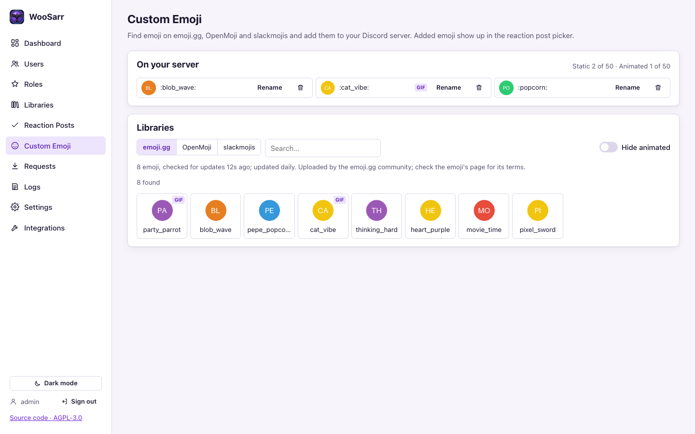

# Discord notes (P0-05)

## Bot permissions by feature

Grant only what the features you use need. WooSarr reads the bot's actual permissions in your server and shows each feature as available or not (Integrations → Discord → *Bot features and permissions*); unavailable features are disabled in the UI and refused with the missing permission named. The same page builds an invite link with exactly the permissions for the features you tick; using it again updates the bot's permissions without removing it.

| Feature | What it does | Permissions | Also needs |
|---------|--------------|-------------|------------|
| **Core** (always) | Read roles and members, react to role changes | *(none)* | **Server Members Intent** (privileged, Developer Portal → Bot) |
| **/link, /unlink, /invite, /help, /request** | Slash commands with private replies; request status DMs | *(none)* | `applications.commands` scope (in the invite link). `/request` is only registered while Seerr is connected; its name is set in Settings → Requests ([requests.md](requests.md)) |
| **Link-status roles** | Give/remove the Verified, Unverified and Linked roles | **Manage Roles** | The bot's highest role must be **above** those roles (Server Settings → Roles, drag the bot's role up) |
| **Create roles** | Create link-status roles and per-library roles from WooSarr | **Manage Roles** | New roles are created at the bottom, below the bot's role |
| **Give and remove roles** | Add or remove roles for many members at once (Users → Discord) | **Manage Roles** | The bot's highest role must be **above** the roles it gives or takes |
| **Reaction posts** | Post the message, add its reactions, give/remove roles when members react | **View Channels, Send Messages, Add Reactions, Read Message History** (in that channel) and **Manage Roles** | The bot's highest role must be **above** the roles the reactions give; guild reactions intent (not privileged; always on) |
| **Public requests** | Post requests in the requests channel mentioning the member; reply there and update the post's status | **View Channels, Send Messages, Embed Links, Read Message History** (in that channel) | Only when *Settings → Requests → Visibility* is **Public**; private requests need none of these |
| **Add and update emoji** | Custom Emoji page: add emoji from emoji.gg, OpenMoji or slackmojis; rename and delete server emoji | **Create Expressions** (add) and **Manage Expressions** (rename/delete any emoji) | Server emoji slots (50 static + 50 animated without boosts) |
| **Clear old reactions** | When you change a reaction post's emoji and turn off *Keep old reactions working*, remove members' old reactions from the message | **Manage Messages** (in that channel) | Optional; without it the old reactions stay on the message but no longer give roles |
| **Pin reaction posts** | Pin the post | **Pin Messages** | Optional; without it the post is still sent, just not pinned |
| **Create the reaction channel** | Create the channel if it doesn't exist | **Manage Channels** | Optional; pick an existing channel instead |

Permission integers (for building links by hand): Manage Roles `268435456`, Manage Channels `16`, View Channels `1024`, Embed Links `16384`, Send Messages `2048`, Manage Messages `8192`, Add Reactions `64`, Read Message History `65536`, Manage Expressions `1073741824`, Create Expressions `8796093022208`, Pin Messages `2251799813685248`. All features: `2260597248978000`.

Channel overrides win over server permissions: if a reaction post channel denies the bot *Send Messages* or *Add Reactions*, the channel list marks it "bot can't post here".

WooSarr never needs Administrator, Kick/Ban or Message Content; Manage Messages only for the optional *Clear old reactions*.

Implementation: `woosarr/services/discord_bot.py` (discord.py 2.7).

## Setup the admin does (Integrations page)

1. Developer Portal → New Application → **Bot**.
2. **Privileged Gateway Intents → Server Members Intent: on.** WooSarr checks this before saving the token: `GET /applications/@me` → `flags` must contain `GATEWAY_GUILD_MEMBERS` (1<<14) or `GATEWAY_GUILD_MEMBERS_LIMITED` (1<<15).
3. **Reset Token** and paste it into WooSarr. It's validated with `GET /users/@me`, stored encrypted as `discord.bot_token`, and never shown again.
   Optional, once connected: **Integrations → Discord → Bot avatar** sets the bot's avatar to WooSarr's icon (default) or an uploaded image, and optionally the application icon too. See *Bot avatar* below.
4. Invite the bot with the link on the Integrations page (`scope=bot applications.commands`). Tick the features you want under *Bot features and permissions* first: the link then asks for exactly their permissions (with none ticked, `permissions=0` is enough for the commands and link syncing). Using the link again later updates the permissions without removing the bot.
5. Pick the server (`GET /users/@me/guilds`). One guild in v1 (D11).

## Runtime

- Intents: `guilds`, `members` and `guild_reactions` (for reaction posts); never message content.
- `/link`, `/unlink`, `/invite`, `/help` and the request command are **guild** commands (`tree.sync(guild=…)`), so they appear immediately (global commands can take up to an hour). The log line `discord commands registered in guild …` lists them.
- On connect: full cache sync (`guild.roles`, `guild.fetch_members()`), then a full reconcile.
- Events → sync queue: `on_member_update` (roles), `on_member_join`, `on_raw_member_remove` (works without the member in cache), `on_guild_role_create/update/delete`.
- Reconnect/resume is discord.py's (`reconnect=True`). `PrivilegedIntentsRequired` and `LoginFailure` are shown on the dashboard and Integrations page; **Restart bot** retries without a container restart.
- DB work runs in `asyncio.to_thread`; Plex calls run on the sync worker, so the gateway heartbeat never waits on Plex.

## `/link`

Ephemeral reply with two buttons:

- **Sign in with Plex (verified)**: WooSarr starts a Plex PIN with a throwaway client id and replies with a link button; it polls for up to 5 min, reads the identity, signs the token out and verifies it's dead (see `plex-notes.md`), then links with `method=oauth`, `verified=true`.
- **Enter Plex username**: modal with one text field; matches a known Plex user by username or email (case-insensitive); `method=username`, `verified=false`. Only offered to members allowed by *Settings → Linking → Who may link by typing a Plex username* (everyone by default); the bot refreshes the member's roles before deciding, and refuses a typed username from anyone else (`link_failed`, reason `username_link_not_allowed`).

Rules (`services/link_service.py`, `linking.decide_link`):

- A Discord member has **one** link. One linked elsewhere must be unlinked first (`discord_already_linked`).
- A Plex account may have **several** members (a family sharing it; see the admin guide). Typing a username never joins an account someone else is linked to (`plex_account_taken`).
- *Sign in with Plex* proves the account: it removes other members' unverified (typed-username) claims. If verified members remain, it joins them only when *Settings → Linking → Shared Plex accounts* is set to allow sign-in; otherwise it's refused and the member is told to ask an admin.
- Per-member cooldown (*Settings → Linking*); every attempt is audited (`link_self` with outcome `created` / `upgraded` / `replaced` / `joined` / `unchanged`, or `link_failed` with the reason and who holds the account). Attempts on someone else's account, takeovers and joins appear in the dashboard's **Alerts**.

## `/unlink`

Ephemeral confirmation (Unlink / Cancel). Effect follows **Settings → Linking → When a member unlinks themselves**:

- *Remove role-granted libraries* (default): a one-user sync with no roles runs first (manual grants and exempt libraries stay; dry-run respected), then the link is deleted, inside the same sync lock so no queued sync can re-grant in between.
- *Leave their access as it is*: the link is deleted; WooSarr stops managing the account.

On a **shared** account the others stay linked and the account keeps what their roles give: *Remove* drops only the libraries this member's roles gave; *Leave as is* turns those libraries into manual grants (`manual_grant_kept`). The confirmation says which applies.

Audited as `unlink_self` (with the policy and the members who remain).

## `/help`

A private reply listing every command the bot has registered with its options: `/link`, `/unlink`, `/invite email [member]`, the request command (under its configured name, only while Seerr is set up) and `/help`. `help` can't be used as the request command's name.

## `/invite email [member]`

- Members holding a role in **Settings → Linking → Plex Invites** may invite **themselves**. Discord admins (*Manage Server* or *Administrator*) may invite for any member (`member` option).
- Libraries = what the target member's roles grant (exempt libraries are never granted by roles). No libraries → refused.
- Refused in dry-run, if the member is already linked or has a pending invite, if the email/username is already on the server (use `/link`), and within the link cooldown. Every attempt is audited (`invite_sent` / `invite_failed`).
- Sends `POST shared_servers` with `invited_email` (python-plexapi `inviteFriend`). When the person accepts, a full sync finds them by email/username and links them (`method=invite`; verified when an admin sent it). Pending invites are listed on the Users page.

## Link-status roles

*Settings → Linking → Discord roles for Plex link status*: pick (or **Create**) a role for **Verified**, **Unverified** and/or **Linked** members. After every sync the bot compares each member's roles with their link and only changes what differs (it never touches other roles). Bots are skipped. Needs *Link-status roles* (Manage Roles + role hierarchy).

These roles can themselves be mapped to libraries on the Roles page, e.g. give every verified member a library.

## Per-library roles

Libraries page → **Create role** opens the same dialog as the Roles page with the name prefilled as `Plex · <library>` (change it to anything), a colour, and that library already ticked (add others if you like). WooSarr creates the role and maps it. Assign the role in Discord and members get the library on the next sync. Needs *Create roles*.

## Roles deleted in Discord

When a role is deleted in Discord (or was deleted while the bot was offline), the Roles page marks it **Deleted in Discord** and keeps its mappings so nothing changes silently. **Remove** (per role) or **Remove N deleted roles** forgets it in WooSarr and cleans up everything that refers to it: role → library mappings, the link-status roles and the *Plex Invites*, *request* and *link by typing a username* role lists in Settings, and reaction-post options that give it (the post's legend is updated). The confirmation lists exactly what will be removed. Roles that still exist in Discord can't be removed here (delete them in Discord first). No one can hold a deleted role, so no Plex access changes; a sync runs anyway when mappings were removed. Audited as `role_removed`.

## Reaction posts

Reaction Posts page:

1. **New post**: message text, channel (existing, or a new channel name; an existing channel with that name is reused), pin on/off, and up to 20 reactions (Discord's limit). Each reaction gives exactly **one Discord role**, chosen from a dropdown (or *＋ Create new role…*); its label in WooSarr is always the role's name. Pick the emoji with the searchable picker (server emoji + common emoji) or paste any emoji / `<:name:id>`. Bot/integration roles can't be chosen.
2. **Legend** (on by default): under the message the bot lists each reaction, one line per reaction from an editable template, e.g. `{emoji} {role} — {libraries}` → "🎬 @Movie Night — Movies, 4K Movies". Placeholders: `{emoji}`, `{role}` (a role mention: shows the role's name and colour, never pings), `{role_name}` (plain text), `{libraries}` (what the role unlocks). Optional heading, and an optional custom line per reaction. The editor shows a live preview and the length (Discord allows 2000 characters).
3. **Save & post**: the bot sends (or edits) the message, adds each reaction, pins it if allowed. Saving again updates the same message; changing the channel posts a new one.
4. Members **react** to get the roles and **remove the reaction** to drop them; a role is kept if another reaction the member kept still gives it. Plex libraries then follow from the normal role → library mappings (Roles page) for linked members, so a reaction role is just like any other role.
5. On every (re)connect the bot re-reads each post's reactions and gives/removes roles to match (catches changes made while it was offline). Disabling a post stops reactions from changing roles; deleting a post leaves the roles members already have.
6. **Changing a published post's emoji or removing a reaction:** the editor lists the members who reacted with each emoji that's going away and what they'll lose, with the Plex impact. For an emoji you replaced, **Keep old reactions working** (on by default) means reactions with the old emoji keep giving the role; the bot takes its own old reaction off so new members use the new one, and WooSarr forgets the old emoji once nobody reacts with it. Turn it off to remove the old reactions when you update the post (needs **Manage Messages**; without it they stay on the message but stop counting); those members get the role back by reacting with the new emoji. Members who reacted to a reaction you removed lose its role when you update the post (their reactions stay on the message). Moving the post to another channel posts a new message, so nobody's reactions carry over.
7. **Automatic updates**: after every sync (role → library mappings, library names) and when a role is renamed or deleted in Discord, the bot re-renders each published post and edits the message only if its text changed. The Reaction Posts page shows *Update pending* until it has.

## Custom emoji

Custom Emoji page (sidebar):

- **Libraries:** three tabs. **emoji.gg** (about 5,400 emoji) and **OpenMoji** (about 2,500, CC BY-SA 4.0: credit OpenMoji where you use them) are downloaded lists that WooSarr keeps in `/config/cache/emoji`, checked at startup (unless checked in the last hour) and then daily; emoji.gg's NSFW category is never shown. If a download fails, the copy from last time is kept, the tab says so, and it's retried an hour later. **slackmojis** has no full list, so it is searched live as you type.
- **Hide animated** (on by default): animated emoji can only be used by members with Discord Nitro and use a separate set of slots. A slackmojis GIF that is really a single frame counts as static.
- **Previews** are fetched by WooSarr, not your browser: only from each source's own image host (`cdn3.emoji.gg`, `cdn.jsdelivr.net`, `emojis.slackmojis.com`), over HTTPS, without following redirects, at most 8 MB, and only PNG, GIF, JPEG or WebP. They are cached on disk (up to 200 MB, oldest dropped first).
- **Add to server:** pick an emoji, check its name (2-32 letters, digits or underscores; prefilled from the title) and add it. WooSarr converts it to fit Discord's limits: still images become a PNG of at most 128 px; animations stay GIFs and are resized frame by frame only if they're over 256 KB. The Discord audit log shows *Added from emoji.gg by admin:… (WooSarr)*; WooSarr's audit trail records the source, the emoji's page and its credit.
- **On your server:** the server's emoji with the used slots (static and animated: 50 each, more with server boosts), **Rename** and **Delete**. Renaming an emoji that a reaction post uses updates the post's options (reactions are matched by name and id). Deleting one that a post still uses is refused; remove it from the post first.
- The bot needs **Create Expressions** to add emoji and **Manage Expressions** to rename and delete them (including emoji others added). The bot receives emoji changes made in Discord straight away (the *guild emojis* intent, not privileged), so the reaction post picker is always current.

## Discord's 3-second limit

Discord gives the bot 3 seconds, from the moment a member uses a command, to answer; after that the member sees *The application did not respond*. So every slash command answers "WooSarr is thinking…" before any of its own work (centrally, in the command tree), and then replies. Buttons and forms do the same (except *Enter Plex username*, whose answer is the form itself). Suggestions while typing (`/request`) can't be acknowledged early; they're kept fast instead.

Every command is logged with how long it took to reach WooSarr and how long the answer took, e.g. `/help from member … acknowledged: reached WooSarr 0.4 s after use, answer took 0.2 s (reused connection; HTTP 204 after 0.2 s)`. Over 2 s to arrive or 1 s to answer is a warning even when Discord still took it. If Discord had already given up, the warning says which side was slow (*Discord (or the network to it) delivered it late* or *sending the answer was slow*), and the member gets a DM asking them to try again (at most once a minute). Ages are measured on Discord's clock: WooSarr estimates the server clock's offset from Discord's replies and mentions it when it's 2 s or more.

To keep answers quick, the bot keeps its connections to Discord open (DNS answers cached for 10 minutes) and makes a tiny request every minute so one is always ready.

## Bot status

The bot shows a custom status under its name in the member list, by default **Try /help for help**. Change it (or leave it empty for none) in *Settings → General → Discord bot status*; the bot updates it right away and sets it again every time it connects. Up to 128 characters, one line.

## Bot avatar

**Integrations → Discord → Bot avatar** (admins, only while the bot is connected):

- **WooSarr icon** (default): the 512 px PNG shipped in the image (`backend/woosarr/assets/bot-avatar.png`, rendered by `make icons`).
- **My own image**: PNG, JPEG or GIF, at least 128×128, up to 8 MB. The type and size are read from the file's bytes (not its name or the browser's claim); SVG and WebP are refused because Discord's image data doesn't take them. Discord shows avatars as circles cropped from the centre; the page previews that.
- **Also use it as the application icon**: also sets the icon in the Developer Portal (and on the bot's profile).

WooSarr sends it with the bot's own token: `PATCH /users/@me {"avatar": "data:…"}` and, if ticked, `PATCH /applications/@me {"icon": "data:…"}`. No permission is needed. Discord allows about **two avatar changes per hour**; beyond that the page says how long to wait. The image isn't stored by WooSarr; each change is audited (`discord_avatar_set` with the image's SHA-256, size and type, or `discord_avatar_failed` with the reason) and logged (`discord avatar updated …`).
